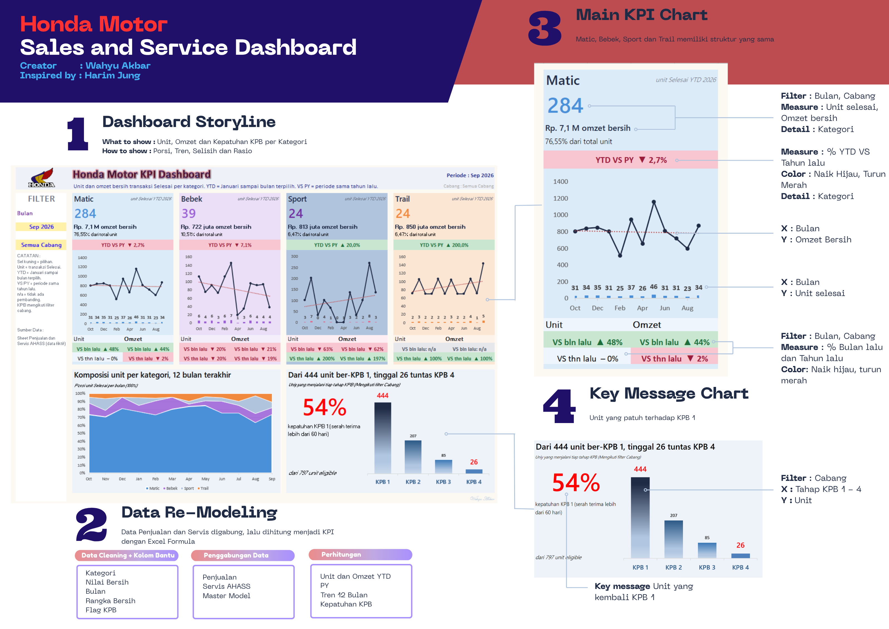

# Honda: Dari Showroom ke Bengkel

**Analisis penjualan dan layanan purna jual dealer Honda dengan Microsoft Excel, dari pembersihan data hingga dashboard KPI interaktif.**

> **Catatan transparansi.** Seluruh data di repositori ini **sintetis**: dibuat acak untuk latihan dan portofolio, bukan data pelanggan atau dealer yang sebenarnya. Kualitas data sengaja dibuat tidak sempurna agar menyerupai kondisi nyata. Harga model hanya ilustrasi. Temuan dan rekomendasi bersifat ilustratif dan tidak menggambarkan dealer Honda mana pun.



## Daftar isi

1. [Ringkasan eksekutif](#1-ringkasan-eksekutif)
2. [Latar belakang dan pertanyaan bisnis](#2-latar-belakang-dan-pertanyaan-bisnis)
3. [Isi repositori](#3-isi-repositori)
4. [Data](#4-data)
5. [Pendekatan analisis](#5-pendekatan-analisis)
6. [Dashboard](#6-dashboard)
7. [Definisi KPI](#7-definisi-kpi)
8. [Temuan utama](#8-temuan-utama)
9. [Masalah kualitas data yang ditemui](#9-masalah-kualitas-data-yang-ditemui)
10. [Masukan untuk manajemen](#10-masukan-untuk-manajemen)
11. [Keterbatasan](#11-keterbatasan)
12. [Keterampilan yang ditunjukkan](#12-keterampilan-yang-ditunjukkan)
13. [Cara menggunakan](#13-cara-menggunakan)
14. [Penulis](#14-penulis)

## 1. Ringkasan eksekutif

Analisis ini menggabungkan data penjualan sepeda motor dan data servis bengkel resmi (AHASS) menjadi satu dashboard KPI. Hasil utama (YTD September 2026, semua cabang):

- **Penjualan datar, nilai naik.** 369 unit Selesai dibanding 362 unit tahun lalu (+1,9%). Omzet bersih Rp 9,39 miliar dibanding Rp 8,94 miliar (+5,0%).
- **Ketergantungan pada Matic.** Matic menyumbang 77,0% unit dan 75,2% omzet, tetapi turun 2,7% YTD. Sport dan Trail hanya 12,7% unit, namun menyumbang 17,3% omzet.
- **Loyalitas servis berkala lemah.** Kepatuhan KPB 1 hanya **54,0%** (430 dari 797 unit). Pada unit yang sudah cukup umur untuk menyelesaikan semua tahap, kepatuhan turun dari 54,2% (KPB 1) ke 30,0% (KPB 2), 16,1% (KPB 3), dan 6,7% (KPB 4).
- **Pembatalan terutama karena kredit ditolak.** 110 dari 1.000 transaksi batal (11,0%), dan 83 di antaranya (75,5%) karena pengajuan kredit ditolak, dengan nilai potensial sekitar Rp 1,98 miliar.
- **Disiplin data entri perlu ditingkatkan.** Ada 13 masalah kualitas data yang didokumentasikan, termasuk nomor rangka tidak seragam, tanggal serah terima yang tidak logis, dan diskon ekstrem.

## 2. Latar belakang dan pertanyaan bisnis

Dealer kendaraan memiliki dua sumber pendapatan yang saling terkait: penjualan unit dan layanan purna jual. Pelanggan yang rutin kembali ke bengkel resmi (KPB) bernilai lebih tinggi dalam jangka panjang, sehingga hubungan antara penjualan dan servis menjadi bahan analisis utama tim CRM.

Pertanyaan yang dijawab:

1. Kategori motor mana yang menggerakkan unit dan omzet, dan bagaimana dibanding tahun lalu?
2. Bagaimana bauran kategori berubah dari bulan ke bulan?
3. Seberapa banyak pelanggan kembali servis berkala, dan di tahap mana mereka berhenti?
4. Cabang, sales, dan sumber prospek mana yang perlu perhatian?
5. Masalah apa pada kualitas data yang mempengaruhi keakuratan angka?

## 3. Isi repositori

```
honda-crm-excel-portfolio/
├── README.md
├── dashboard/
│   ├── Honda_Motor_KPI_Dashboard.xlsx          Dashboard utama (filter Bulan dan Cabang)
│   └── Honda_Motor_Ocean_Theme_Dashboard.xlsx  Dashboard bertema laut (4 grafik)
├── data/
│   ├── Honda_Motor_Sales_Service_Dataset.xlsx  Dataset A: penjualan dan servis motor
│   ├── Honda_Car_CRM_Dataset.xlsx              Dataset B: CRM pelanggan mobil
│   └── csv/                                    Versi CSV dari semua tabel
├── docs/
│   ├── data_dictionary.md                      Kamus data
│   ├── data_quality_log.md                     Catatan masalah data (rinci)
│   └── methodology.md                          Re-modeling, rumus, dan validasi
└── images/                                     Tangkapan layar dashboard
```

## 4. Data

### Dataset A: penjualan dan servis motor (data utama)

| Sheet | Isi | Baris |
|---|---|---|
| Penjualan | Transaksi motor Jan 2025 sampai Okt 2026 (model, cabang, sales, kredit, diskon, status, serah terima) | 1.000 |
| Servis_AHASS | Kunjungan servis (KPB 1 sampai 4, servis rutin, ganti oli, perbaikan) | 1.270 |
| Master_Model | Kode, kategori, kapasitas, dan harga ilustrasi 12 model | 12 |
| Master_Sales | Cabang dan target unit bulanan 10 sales | 10 |
| Master_Bonus | Tabel bonus bertingkat | 5 |

Penjualan dan Servis_AHASS dihubungkan lewat **No_Rangka**. Tanggal acuan analisis adalah **22 Oktober 2026**.

### Dataset B: CRM pelanggan mobil (data pendukung)

| Sheet | Isi | Baris |
|---|---|---|
| Data_Pelanggan | Pembelian mobil Jan 2022 sampai Sep 2026, riwayat servis terakhir, status follow-up, rating | 1.000 (985 pelanggan unik) |
| Master_Model | Kategori dan harga ilustrasi 8 model | 8 |

Tanggal acuan Dataset B adalah **19 Oktober 2026**. Kamus data lengkap ada di [docs/data_dictionary.md](docs/data_dictionary.md).

## 5. Pendekatan analisis

| Tahap | Kegiatan | Alat di Excel |
|---|---|---|
| 1. Profil data | Memeriksa struktur, sel kosong, duplikat, nilai ekstrem | Filter, `COUNTIF`, `QUARTILE` |
| 2. Pembersihan | Merapikan nama, nomor HP, dan nomor rangka | `TRIM`, `UPPER`, `PROPER`, `SUBSTITUTE`, `MID` |
| 3. Re-modeling | Join antar tabel, kolom bantu, penanda (flag) | `INDEX`, `MATCH`, `DATE`, `IF`, `AND`, `COUNTIFS` |
| 4. Perhitungan KPI | YTD, pembanding tahun lalu, porsi, rasio, kepatuhan KPB | `COUNTIFS`, `SUMIFS`, `EDATE`, `SUMPRODUCT` |
| 5. Visualisasi | Kartu KPI, grafik kombinasi, area 100%, filter | Combo chart, conditional formatting, data validation |
| 6. Validasi | Pencocokan silang dengan perhitungan terpisah dan uji filter | Python (pandas) sebagai pembanding |

### Ringkasan re-modeling

| Langkah | Hasil |
|---|---|
| Membersihkan kunci | `Rangka_Bersih` = `UPPER(TRIM(No_Rangka))` agar Penjualan dan Servis bisa dihubungkan |
| Join dari master | `Kategori` dan `Nilai_Bersih` (harga dikurangi diskon) per transaksi |
| Dimensi waktu | `Bulan` = tanggal pertama tiap bulan untuk pengelompokan |
| Join antar tabel fakta | `Cabang` dibawa ke Servis_AHASS lewat nomor rangka |
| Penanda KPB | `Eligible_KPB1` (serah terima lebih dari 60 hari lalu) dan `Sudah_KPB1` |
| Lapisan parameter | Pilihan Bulan dan Cabang menjadi kriteria perhitungan (`*` untuk semua cabang) |
| Tabel agregasi | Tabel kategori, tabel 12 bulan, dan tabel KPB di sheet `KPI_Data` |

Detail rumus ada di [docs/methodology.md](docs/methodology.md).

## 6. Dashboard

**Honda_Motor_KPI_Dashboard.xlsx** meniru struktur dashboard KPI bergaya template: empat kartu kategori (Matic, Bebek, Sport, Trail), badge naik-turun berwarna, grafik kombinasi dengan sumbu ganda, grafik komposisi, dan satu pesan kunci.

Fitur:

- **Filter interaktif:** dropdown Bulan (Jan 2025 sampai Sep 2026) dan Cabang (Semua atau per cabang) pada sel kuning di sidebar.
- **Kartu KPI per kategori:** unit YTD, omzet bersih, porsi, dan badge YTD VS PY.
- **Kotak UNIT dan OMZET:** perbandingan dengan bulan lalu dan tahun lalu.
- **Grafik kombinasi:** batang unit dan garis omzet selama 12 bulan.
- **Grafik komposisi:** porsi unit per kategori (area 100%).
- **Pesan kunci:** kepatuhan KPB 1 dan tangga KPB 1 sampai 4, mengikuti filter cabang.
- **Judul dinamis:** teks pesan kunci dibuat dengan rumus sehingga ikut berubah mengikuti data.

Sheet pada workbook: `KPI_Dashboard` (tampilan), `KPI_Data` (perhitungan), lalu sheet data sumber. Kolom bantu ditambahkan di `Penjualan` (T sampai Y) dan `Servis_AHASS` (K).

**Honda_Motor_Ocean_Theme_Dashboard.xlsx** menampilkan empat grafik bertema laut (lollipop model terlaris, gelembung kontribusi cabang, tren bulanan, dan tangga KPB).


## 7. Definisi KPI

| KPI | Definisi |
|---|---|
| Unit Selesai | Jumlah transaksi berstatus Selesai |
| Omzet bersih | Jumlah (harga model dikurangi diskon) untuk transaksi Selesai |
| Porsi unit | Unit kategori dibagi total unit YTD |
| YTD VS PY | Unit YTD dibagi unit YTD tahun lalu, dikurangi 1 ("n/a" bila pembanding 0) |
| VS bulan lalu, VS tahun lalu | Perubahan unit atau omzet bulan terpilih terhadap bulan sebelumnya atau bulan yang sama tahun lalu |
| Kepatuhan KPB 1 | Unit Selesai yang diserahkan lebih dari 60 hari lalu dan sudah punya servis "KPB 1", dibagi seluruh unit Selesai yang diserahkan lebih dari 60 hari lalu |
| Tangga KPB | Jumlah unit yang menjalani KPB 1, 2, 3, dan 4 |
| Retention rate (Dataset B) | Pelanggan dengan minimal 1 kunjungan servis dibagi pelanggan unik |

Batas 60 hari adalah toleransi analisis, bukan aturan resmi Honda. Ketentuan KPB sebenarnya berbeda antar model dan dapat berubah.

## 8. Temuan utama

### Penjualan dan kategori (YTD September 2026)

| Kategori | Unit | vs tahun lalu | Omzet bersih | Omzet per unit |
|---|---|---|---|---|
| Matic | 284 | -2,7% | Rp 7,06 M | Rp 24,9 juta |
| Bebek | 38 | -9,5% | Rp 0,70 M | Rp 18,5 juta |
| Sport | 24 | +20,0% | Rp 0,81 M | Rp 33,9 juta |
| Trail | 23 | +187,5% | Rp 0,81 M | Rp 35,4 juta |
| **Total** | **369** | **+1,9%** | **Rp 9,39 M** | |

- Porsi Matic bergerak antara 64% (Agustus 2026) dan 85% (Mei 2026) dalam 12 bulan terakhir.
- Sport dan Trail masing-masing hanya diwakili satu model (CB150R dan CRF150L). Kenaikan Trail berasal dari basis kecil (8 menjadi 23 unit), sehingga persentasenya perlu dibaca bersama angka dasarnya.
- BeAT adalah model terlaris di kelima cabang (169 unit).

### Layanan purna jual

- Kepatuhan KPB 1 sebesar 54,0%. Tangga KPB: 444, 207, 85, dan 26 unit untuk KPB 1 sampai 4.
- Setelah disesuaikan umur unit (330 unit yang diserahkan lebih dari 400 hari lalu): KPB 1 sebesar 54,2%, KPB 2 sebesar 30,0%, KPB 3 sebesar 16,1%, dan KPB 4 sebesar 6,7%. Jadi penurunan bukan sekadar karena unit masih baru.
- 367 unit sudah melewati jendela KPB 1 tanpa servis (median 349 hari sejak serah terima). Ada juga 61 unit yang masih dalam jendela dan belum KPB 1, dan 32 di antaranya sudah 30 hari atau lebih.
- Kepatuhan per cabang berkisar 50,0% (Timur) sampai 56,1% (Selatan dan Barat).
- Rating layanan servis rata-rata 4,30 dari 1.015 responden (79,9% kunjungan).

### Kredit dan pembatalan

- 70,3% transaksi memakai kredit leasing. Tingkat persetujuan kredit 88,0%: Leasing Nusa 90,8%, Leasing Mitra 88,2%, Leasing Sentosa 85,2%.
- 110 transaksi batal (11,0%), dan 83 di antaranya karena kredit ditolak. 21 lainnya batal walau kredit disetujui, dan 6 batal pada pembayaran tunai.

### Sales, waktu, dan sumber prospek

- Dua sales teratas menyumbang 29,4% omzet bersih (Rp 3,35 M dan Rp 3,08 M dari Rp 21,9 M).
- Pada September 2026, 4 dari 10 sales berada di bawah target unit bulanan.
- Sabtu dan Minggu menyumbang 36,9% transaksi (198 dan 171 dari 1.000).
- Lead time serah terima rata-rata 7,6 hari (1 sampai 14 hari) pada 862 transaksi valid.
- Sumber prospek unit Selesai: walk-in 33,3%, media sosial 23,3%, referral 19,7%, pameran 14,9%, telemarketing 8,8%. Telemarketing memiliki tingkat batal tertinggi (15,1%), meski sampelnya kecil.

### Dataset B: CRM pelanggan mobil

- Segmentasi follow-up berdasarkan hari sejak servis terakhir: Segera Hubungi 417 pelanggan (42,3%), Pantau 156 (15,8%), Aman 283 (28,7%), Belum Pernah Servis 129 (13,1%).
- Retention rate 86,9% (856 dari 985 pelanggan). Per model berkisar 82,6% (Mobilio) sampai 94,0% (City Hatchback).
- Status follow-up: 277 pelanggan (28,1%) belum dihubungi dan 127 (12,9%) tidak mengangkat telepon.
- Rata-rata rating kepuasan 4,20 dari 501 responden (50,9% pelanggan).

## 9. Masalah kualitas data yang ditemui

Masalah berikut sengaja disisipkan dalam data sintetis untuk mensimulasikan kondisi nyata. Rincian cara mendeteksi dan menangani ada di [docs/data_quality_log.md](docs/data_quality_log.md).

| No | Dataset | Masalah | Temuan | Dampak jika dibiarkan | Penanganan dalam analisis |
|---|---|---|---|---|---|
| 1 | A | Nomor rangka tidak seragam | 41 berhuruf kecil, 30 berspasi di akhir | Penghubungan Penjualan dan Servis gagal pada 28 baris servis; kepatuhan KPB 1 terhitung 52,6% (419 unit), bukan 54,0% (430 unit) | Kolom `Rangka_Bersih` dengan `UPPER(TRIM())` |
| 2 | A | Tanggal serah terima sebelum tanggal transaksi | 10 transaksi (selisih -5 sampai -2 hari) | Rata-rata lead time menjadi 7,44 hari, bukan 7,56 hari | Ditandai, lalu dikeluarkan dari rata-rata lead time (`AVERAGEIFS` dengan kriteria `>=0`) |
| 3 | A | Diskon ekstrem | 8 transaksi dengan diskon Rp 9 sampai 15 juta (total Rp 96 juta; 6 di antaranya Selesai, Rp 75 juta), padahal diskon wajar maksimum Rp 1,5 juta | Omzet bersih terdistorsi, indikasi salah input atau diskon tanpa kontrol | Dideteksi dengan batas IQR (Q3 + 1,5 × IQR = Rp 2,375 juta), ditandai conditional formatting, tetap dihitung dengan catatan |
| 4 | A | Nama konsumen tidak seragam | 62 berawalan Bpk./Ibu/Sdr., 53 berspasi di akhir, 17 huruf kapital semua | Sulit mencocokkan atau menghapus duplikat, sapaan telepon tidak rapi | `TRIM`, `SUBSTITUTE`, `PROPER` |
| 5 | A | Transaksi belum final dan tanggal serah kosong | 128 baris tanpa tanggal serah (110 Batal, 18 Dalam Proses) | Sel kosong yang dihitung 0 menurunkan rata-rata, status belum final ikut terhitung | Hanya status Selesai dihitung; sel kosong dibiarkan kosong, bukan 0 |
| 6 | A | Bulan berjalan belum lengkap | Oktober 2026 hanya 8 unit Selesai (data sampai 20 Oktober) | Tren terlihat turun padahal belum lengkap | Oktober dikeluarkan dari tren dan dropdown bulan |
| 7 | A | Kategori kecil dengan satu model | Sport (24 unit) dan Trail (23 unit) YTD, masing-masing satu model | Persentase ekstrem (Trail +187,5%) menyesatkan | Angka dasar ditampilkan, badge "n/a" bila pembanding 0 |
| 8 | A | Rating layanan tidak lengkap | 255 dari 1.270 kunjungan (20,1%) tanpa rating | Rata-rata hanya mewakili responden | `AVERAGE` mengabaikan sel kosong; jumlah responden dilaporkan |
| 9 | B | Baris duplikat | 15 dari 1.000 baris (985 pelanggan unik) | Jumlah pelanggan dan total biaya terlalu besar 1,5% | Hapus duplikat berdasarkan baris penuh, dihitung unik dengan `SUMPRODUCT(1/COUNTIF())` |
| 10 | B | Format nomor HP tidak seragam | 63 berawalan +62, 127 memakai tanda hubung, 40 tanpa angka 0 di depan (kategori bisa tumpang tindih) | Nomor tidak bisa dihubungi atau dikirimi WhatsApp secara massal | `SUBSTITUTE` dan `MID` untuk menyeragamkan ke 08xxxxxxxxxx |
| 11 | B | Nama pelanggan tidak seragam | 64 berspasi di akhir, 44 huruf kecil semua, 28 huruf kapital semua, 20 berspasi ganda | Pencocokan nama dan personalisasi tidak rapi | `TRIM` dan `PROPER` |
| 12 | B | Pelanggan belum pernah servis | 129 dari 985 pelanggan (13,1%) tanpa tanggal servis | Sel kosong dibaca 0 dan salah masuk segmen "Aman" | Segmen sendiri "Belum Pernah Servis", diperiksa lebih dulu dalam rumus segmentasi |
| 13 | B | Rating tidak lengkap | 484 dari 985 pelanggan (49,1%) tanpa rating | Rata-rata 4,20 hanya mewakili setengah pelanggan | Rata-rata dari responden, jumlah responden dilaporkan |

## 10. Masukan untuk manajemen

Masukan di bawah ini berdasarkan data sintetis, sehingga angka target bersifat usulan ilustratif.

| Prioritas | Area | Temuan | Rekomendasi | Usulan indikator |
|---|---|---|---|---|
| Tinggi | Servis berkala (KPB) | Kepatuhan KPB 1 hanya 54,0%, dan tangga turun sampai 6,7% pada KPB 4 | Kirim pengingat terjadwal (misalnya sekitar hari ke-25 dan ke-45 setelah serah terima), telepon 61 unit yang masih dalam jendela (prioritaskan 32 unit yang sudah 30 hari atau lebih), dan aktifkan kembali 367 unit yang sudah lewat jendela dengan penawaran servis berikutnya | Kepatuhan KPB 1 di atas 65%, KPB 2 di atas 40% |
| Tinggi | Pembatalan kredit | 83 transaksi (Rp 1,98 miliar) batal karena kredit ditolak; tingkat persetujuan Leasing Sentosa terendah (85,2%) | Lakukan pra-penyaringan kelayakan kredit sebelum pesanan, siapkan jalur cadangan ke leasing lain, dan tinjau kemitraan dengan leasing yang paling sering menolak | Batal karena kredit ditolak di bawah 5% |
| Tinggi | Kontrol diskon | 8 diskon ekstrem (Rp 96 juta), sementara 39,3% transaksi tanpa diskon | Terapkan persetujuan berjenjang untuk diskon di atas ambang (misalnya Rp 2,4 juta) dan audit 8 transaksi yang ditandai | Tidak ada diskon di atas ambang tanpa persetujuan |
| Menengah | Bauran produk | Matic 77% unit dan turun 2,7%; Sport dan Trail bernilai Rp 34 sampai 35 juta per unit tetapi basisnya kecil | Jaga stok dan promosi Matic, tambah unit demo dan acara test ride Sport dan Trail, dan pantau analisis per model karena tiap kategori hanya satu model | Porsi omzet Sport dan Trail naik di atas 20% |
| Menengah | Segmen Bebek | Turun 9,5% YTD dan 20% dibanding September tahun lalu, dengan nilai per unit terendah | Tentukan peran segmen ini (entry-level dengan pembiayaan ringan atau diperkecil sengaja) dan evaluasi per cabang | Keputusan strategi segmen tertulis |
| Menengah | Cabang | Kepatuhan KPB 1 Cabang Timur 50,0%, terendah | Selidiki penyebab (kapasitas bengkel, kontak pelanggan) dan terapkan praktik cabang dengan kepatuhan tertinggi | Selisih antar cabang di bawah 3 poin |
| Menengah | Sales dan insentif | Dua sales teratas 29,4% omzet; 4 dari 10 sales di bawah target September; tangga bonus 3, 5, 8, 12 unit membuat selisih satu unit berdampak besar | Tinjau kerataan beban dan target antar sales, beri pendampingan, dan evaluasi apakah tangga bonus mendorong perilaku yang diinginkan | Jumlah sales di bawah target menurun |
| Menengah | Follow-up CRM (mobil) | 277 pelanggan (28,1%) belum dihubungi, 127 (12,9%) tidak mengangkat; 417 pelanggan berstatus Segera Hubungi | Tetapkan SOP percobaan ulang (beberapa hari dan jam berbeda, termasuk WhatsApp) dan mulai dari segmen Segera Hubungi | Pelanggan belum dihubungi di bawah 10% |
| Rendah | Penjadwalan | Sabtu dan Minggu 36,9% transaksi | Atur jadwal sales, stok unit demo, dan jam layanan agar kuat di akhir pekan | Waktu tunggu konsumen akhir pekan |
| Rendah | Sumber prospek | Walk-in 33,3% dan media sosial 23,3% unit Selesai; telemarketing batal tertinggi (15,1%, sampel kecil) | Pertahankan walk-in dan media sosial, dan tinjau naskah serta penyaringan prospek telemarketing sebelum menambah anggaran | Tingkat batal telemarketing turun |
| Rendah | Kualitas data | 13 masalah data tercatat (rangka, tanggal, diskon, nama, HP, duplikat) | Validasi saat input: huruf kapital otomatis dan panjang 15 karakter untuk rangka, tanggal serah tidak boleh lebih awal dari transaksi, kunci unik anti-duplikat, dan format HP seragam | Jumlah temuan data per bulan menurun |

## 11. Keterbatasan

- **Data sintetis.** Pola dan angka tidak mencerminkan dealer nyata. Tujuan repositori ini adalah menunjukkan cara kerja analisis, bukan menarik kesimpulan bisnis nyata.
- **Harga model ilustrasi.** Omzet dihitung dari harga di Master_Model dikurangi diskon, sehingga bukan angka akuntansi.
- **Kategori kecil.** Sport dan Trail masing-masing satu model, sehingga persentase perubahannya mudah melonjak.
- **Panel KPB tidak mengikuti pilihan bulan.** Panel itu mengikuti filter cabang saja dan dihitung terhadap tanggal acuan 22 Oktober 2026.
- **Aturan KPB disederhanakan.** Jendela 60 hari adalah asumsi analisis. Syarat KPB sebenarnya berbeda antar model.
- **Rekomendasi bersifat ilustratif.** Usulan target belum diuji secara statistik, dan perbedaan antar kelompok kecil (misalnya antar sumber prospek) tidak diuji signifikansinya.

## 12. Keterampilan yang ditunjukkan

- **Pembersihan data:** `TRIM`, `UPPER`, `PROPER`, `SUBSTITUTE`, `MID`, `LEFT`, `LEN`, `IFERROR`
- **Lookup dan join:** `INDEX`, `MATCH`, `VLOOKUP` (pencocokan persis dan perkiraan)
- **Agregasi bersyarat:** `COUNTIFS`, `SUMIFS`, `AVERAGEIFS`, `SUMPRODUCT`
- **Tanggal:** `DATE`, `EDATE`, `EOMONTH`, `WEEKDAY`
- **Statistik:** `QUARTILE` dan batas IQR, `RANK`, `LARGE`
- **Visualisasi:** grafik kombinasi sumbu ganda, area 100%, lollipop dengan error bars, gelembung, piramida 3-D
- **Interaktivitas:** data validation (dropdown), conditional formatting, judul dinamis
- **Pemodelan data:** tabel fakta dan dimensi, kolom bantu, penanda, dan lapisan parameter
- **Validasi:** pencocokan silang dengan Python (pandas) dan uji filter

## 13. Cara menggunakan

1. Unduh repositori ini (**Code > Download ZIP**) atau salin foldernya.
2. Buka `dashboard/Honda_Motor_KPI_Dashboard.xlsx` di Microsoft Excel. Pastikan **Formulas > Calculation Options** berada pada **Automatic**.
3. Di sheet `KPI_Dashboard`, klik sel kuning **Bulan** dan **Cabang** di sidebar untuk mengganti tampilan.
4. Telusuri perhitungan di sheet `KPI_Data`, dan data sumber di sheet `Penjualan` dan `Servis_AHASS`.
5. Untuk memakai data di alat lain (Power BI, Python, SQL), gunakan file di `data/csv/`.

Rumus ditulis dengan pemisah koma pada dokumentasi. Jika Excel Anda memakai pengaturan regional Indonesia, ganti koma dengan titik koma.

Dashboard dirancang untuk Microsoft Excel desktop. Beberapa tampilan grafik (piramida 3-D, lollipop dengan error bars, dan label gelembung) mungkin berbeda di Google Sheets atau LibreOffice.

## 14. Penulis

**Wahyu Akbar** — Data Analyst

- LinkedIn: https://www.linkedin.com/in/akbarparsan/
- Email: akbarparsan@gmail.com
- Portofolio lain: https://github.com/akbarparsan/smelter-reliability-energy-analytics
                   https://github.com/akbarparsan/smelter-performance-dashboard
